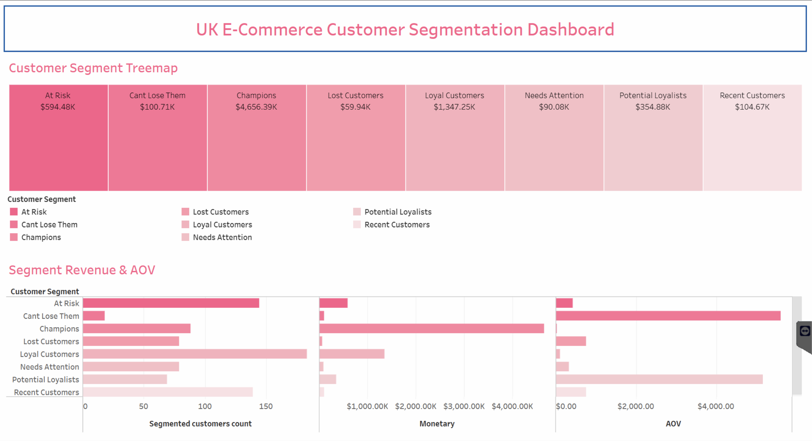

# 🛒 E-Commerce Customer Segmentation & RFM Analytics Dashboard

An end-to-end data analytics project categorizing customer purchasing behavior using **MySQL Workbench** and **Tableau Public** on the UK Online Retail dataset.

---

## 📊 Live Interactive Dashboard

🔗 **[Click Here to View Live Tableau Dashboard](https://public.tableau.com/views/UkCustomerRfmSegment/Dashboard1?:language=en-GB&:sid=&:redirect=auth&:display_count=n&:origin=viz_share_link)**

---

## 🛠️ Tech Stack & File Structure

* **Database & Data Pipeline:** MySQL Workbench, SQL (`03_rfm_segmentation.sql`)
* **Data Sources:** Cleaned transaction logs (`Online_Retail_Cleaned.csv`) & SQL RFM Output (`UK_Customer_RFM_Segments.csv`)
* **Data Visualization:** Tableau Public

---

## 📌 Key Insights & Features

* **Revenue Concentration:** The **Champions** segment accounts for **71.07% (£1,385,784)** of total revenue despite representing only **21.25% (78)** of total unique customers.
* **Re-Engagement Opportunity:** **Lost Customers (109)** and **At Risk / Can't Lose (39)** segments represent **£300,970** in historical value, serving as the primary target for win-back marketing campaigns.
* **Dynamic Metric Tracking:** Interactively tracks overall Average Order Value (£438.97) and cross-filters revenue contribution across all 6 RFM customer cohorts.
